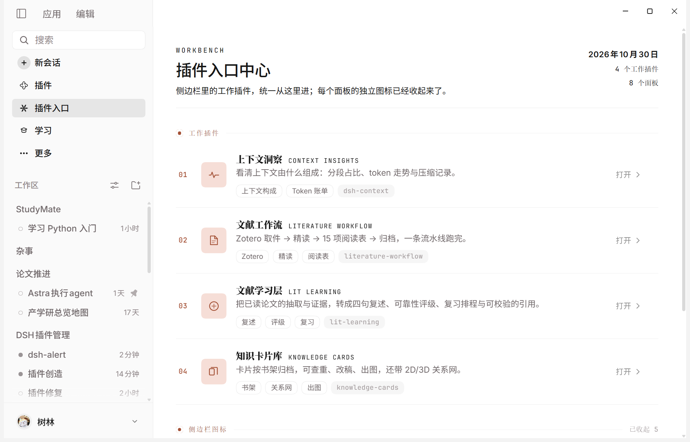
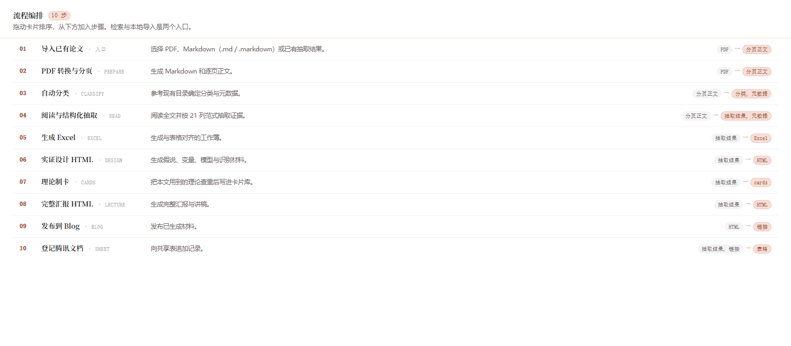

# DSH Literature Suite (English)

**Turn "read a paper" into a resumable pipeline with real artifacts.**

A set of literature plugins for [DeepSeek Harness](https://github.com/deepseek-ai/deepseek-harness) (DSH): search, PDF→Markdown, structured extraction, Zotero filing, Excel sheets, knowledge cards, a review learning layer, and publishing — four plugins, each owning one segment, none overreaching into another's data.

<p align="center">
  
</p>

## Why

Producing a paper's deliverables means repeating the same chores: find the PDF, convert it, fill abstract/theory/contribution into fixed fields, file it into a Zotero collection, generate a spreadsheet, write knowledge cards, build slides, register the publication. Every step is a different tool and a different folder.

These plugins chain those steps into one pipeline and hold three invariants:

- **Every stage declares its input and output** — artifacts land somewhere you can point at.
- **Every stage can stop** — jobs pause and resume; a long run does not have to finish in one sitting.
- **Every plugin has a read-only boundary** — the learning layer never writes the card library; the card library never rewrites workflow output.

## Plugins

| Package | What it does | Shape |
|---|---|---|
| [`literature-workflow`](packages/literature-workflow) | The pipeline: search → PDF→Markdown → extraction → Zotero → Excel → card task sheet → slides → publish | Host tools + native page + Python bridge |
| [`knowledge-cards`](packages/knowledge-cards) | Card library: shelf browsing, deduplication, editing, export, 2D/3D relation graphs | Host tools + native page |
| [`lit-learning`](packages/lit-learning) | Learning layer: read-only over upstream output — recital, readiness ratings, citation drafts, review items, field map | Host tools + native page |
| [`@ysl289/dsh-plugin-hub`](packages/plugin-hub) | Launcher: collapses the sidebar icons of the above (and any panel) into one entry page | Pure front-end panel |

Optional skills: [`skills/knowledge-card-library`](skills/knowledge-card-library), [`skills/literature-pipeline`](skills/literature-pipeline).

## Pipeline

```
search/import → PDF→Markdown → extraction(extract.json) → Zotero filing → Excel → card task sheet → slides(HTML) → publish(optional)
                                                                          ↘ knowledge cards (separate plugin)
                                                                                ↘ learning layer (separate plugin, read-only)
```

<p align="center">
  
</p>

Stages can be reordered by drag, given per-stage prompt overrides, and paused after any step. State lives in `.plugin-state/` under the workflow root, so quitting and returning resumes the same run.

## Quick start

### Requirements

DSH `0.2.x` (tested on `0.2.1-rc.3`), Node.js ≥ 22, Python ≥ 3.10 with `openpyxl`, `requests`, `PyMuPDF`. Zotero and Tencent Docs are optional integrations. **Windows is the primary tested platform.**

### Install

> **Not published to npm yet** — install from the git URL or a local directory.
> (The `dsh-plugin-hub` on npm belongs to a **different author** and is a plugin marketplace; this project's launcher is `@ysl289/dsh-plugin-hub`.)

**Option 1 — paste the URLs into DSH's plugin page**

Open **sidebar → Plugins → Add plugin** and paste:

```
https://github.com/ysl289/dsh-literature-workflow.git#packages/literature-workflow
https://github.com/ysl289/dsh-literature-workflow.git#packages/knowledge-cards
https://github.com/ysl289/dsh-literature-workflow.git#packages/lit-learning
https://github.com/ysl289/dsh-literature-workflow.git#packages/plugin-hub
```

> Sub-directory specs (`#packages/...`) depend on your DSH version. If unsupported, use option 2.

**Option 2 — clone, then install from the local directories (most reliable)**

```bash
git clone https://github.com/ysl289/dsh-literature-workflow.git
cd dsh-literature-workflow
python -m pip install -r requirements.txt

dsh plugin --profile <profile> add ./packages/literature-workflow
dsh plugin --profile <profile> add ./packages/knowledge-cards
dsh plugin --profile <profile> add ./packages/lit-learning
dsh plugin --profile <profile> add ./packages/plugin-hub     # optional

cp -r skills/knowledge-card-library ~/.dsh/skills/
cp -r skills/literature-pipeline ~/.dsh/skills/
```

Restart DSH after installing the plugins. Paths are never hard-coded: configure via `DSH_LIT_WORKFLOW`, `DSH_CARDS_HOME`/`KCARD_HOME`, `DSH_LIT_LEARNING` and `DSH_PYTHON`, or fall back to home-directory defaults.

Publishing defaults to **preview** — nothing is written to Zotero or Tencent Docs until you enable it on the workflow page.

## Safety boundaries

- **No API keys stored** — model calls go through DSH's own provider configuration.
- **Authorization stays client-side** — Zotero handles its own prompts; Tencent Docs uses official OAuth, and tokens stay in the workflow state directory, never in logs.
- **Read-only is enforced** — the learning layer reads cards and workflow output; the only writable paths are its own directory and an append-only `review/log.jsonl`.
- **Deletion is confirmed** — both templates and tasks require a second confirmation with a preview of what will be removed.

## Development

```bash
node scripts/check.mjs          # syntax-check every host module and client bundle
node scripts/test.mjs           # Node tests for all four packages
python -m pytest packages/literature-workflow/tests -q
```

Pure ESM, no build step; `client.js` is a prebuilt client bundle committed to the repo.

## Docs

Chinese documentation is authoritative: [README.md](README.md), [docs/configuration.md](docs/configuration.md), [docs/architecture.md](docs/architecture.md), [docs/troubleshooting.md](docs/troubleshooting.md).

## License

MIT. See [LICENSE](LICENSE).
