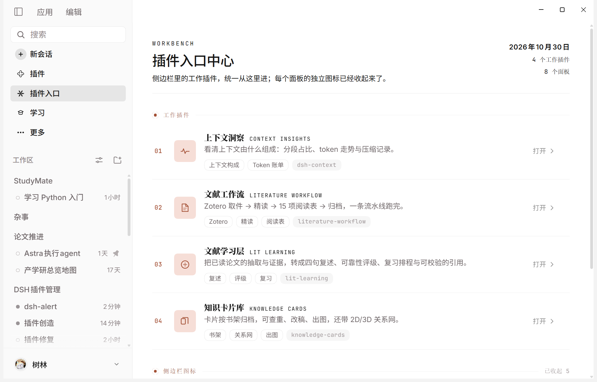
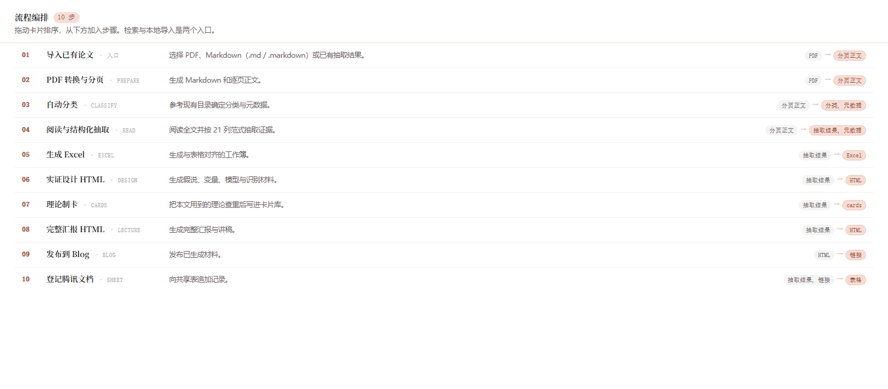
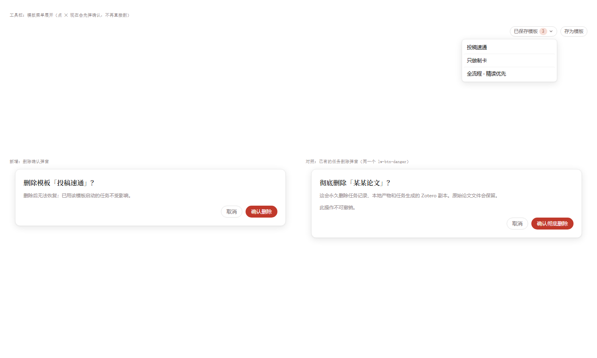

# DSH Literature Suite

**把「读一篇论文」变成一条可暂停、可续跑、有产物的流水线。**

一套给 [DeepSeek Harness](https://github.com/deepseek-ai/deepseek-harness)（下称 DSH）用的文献工作插件集：检索、PDF→Markdown、结构化抽取、Zotero 归档、Excel 表、知识卡片、学习层复习、发布登记——四个插件各管一段，边界清晰，互不越权。

<p align="center">
  
</p>

<p align="center">
  <a href="LICENSE"></a>
  
  
  
  
</p>

---

## 为什么做这个

做一篇论文的「可交付材料」，重复劳动是这样的：找 PDF → 转 Markdown → 把摘要/理论/贡献填进固定字段 → 放进 Zotero 分类 → 生成 Excel → 写知识卡片 → 做演示页 → 登记发布。每一步都在换工具、换格式、换目录。

这套插件把它们串成一条流水线，并且坚持三件事：

- **每一步都有明确的输入输出**——不是「AI 帮我搞定」，而是看得见产物落在哪。
- **每一步都能停下来**——任务可暂停、可续跑，长流程不用一次熬完。
- **每个插件都有只读边界**——学习层永远不写卡片库，卡片库永远不改工作流产物。

## 四个插件

| 包 | 一句话 | 形态 |
|---|---|---|
| [`literature-workflow`](packages/literature-workflow) | 主流程：检索 → PDF→Markdown → 抽取 → Zotero → Excel → 制卡任务书 → 演示页 → 发布 | Host 工具 + 原生页面 + Python bridge |
| [`knowledge-cards`](packages/knowledge-cards) | 卡片库：按「形态 × 书架」浏览、查重、编辑、导出，内置 2D/3D 关系网 | Host 工具 + 原生页面 |
| [`lit-learning`](packages/lit-learning) | 学习层：只读上游产物，生成复述、准备度评级、引用草稿、复习题与领域地图 | Host 工具 + 原生页面 |
| [`plugin-hub`](packages/plugin-hub) | 入口中心：把上面三个（及任何面板）的侧边栏图标收进一个启动台 | 纯前端面板 |

配套技能（可选但推荐）：[`skills/knowledge-card-library`](skills/knowledge-card-library)、[`skills/literature-pipeline`](skills/literature-pipeline)。

## 流水线长什么样

```
检索/导入 → PDF→Markdown → 抽取(extract.json) → Zotero 落盘 → Excel 表 → 制卡任务书 → 演示页(HTML) → 发布(可选)
                                                                      ↘ 知识卡片库（独立插件）
                                                                            ↘ 学习层（独立插件，只读）
```

<p align="center">
  
</p>

十步流程在页面上可拖动排序、可单独配置每步提示词、可在任意一步之后暂停。产物落在工作流根目录的 `.plugin-state/`，退出再进来接着跑。

## 快速开始

### 环境

| 依赖 | 版本 | 必需性 |
|---|---|---|
| DeepSeek Harness | `0.2.x`（验证于 `0.2.1-rc.3`） | 必需 |
| Node.js | ≥ 22 | 必需 |
| Python | ≥ 3.10（验证于 3.13） | 必需（PDF 转换、Excel、腾讯文档桥接） |
| Python 包 | `openpyxl`、`requests`、`PyMuPDF` | 必需 |
| Zotero | 7.x，开启本地 API | 可选（不装则跳过落盘/回执） |
| 腾讯文档 | 账号 + 官方授权 | 可选（不装则跳过发布） |

### 安装

```bash
git clone https://github.com/ysl289/dsh-literature-workflow.git
cd dsh-literature-workflow
python -m pip install -r requirements.txt
```

```bash
# <profile> 换成你的 profile 名（Web 端通常是 desktop 或 web）
dsh plugin --profile <profile> add ./packages/literature-workflow
dsh plugin --profile <profile> add ./packages/knowledge-cards
dsh plugin --profile <profile> add ./packages/lit-learning
dsh plugin --profile <profile> add ./packages/plugin-hub     # 可选
```

没有全局 `dsh` 命令时，在 DSH 源码 checkout 里用 `pnpm dsh plugin --profile <profile> add <路径>`，或在 DSH 的 **插件 → 添加插件** 里粘贴目录绝对路径。

> `literature-workflow` 已内置 `assets/`（PDF→Markdown、Excel、HTML 演示页、卡片、发布脚本与模板），
> **不需要另外准备原工作流目录**；`workflowRoot` 只用于 `input/`、`.plugin-state/` 和产物。
> 若该目录里也有 `src/` 或 `templates/`，会优先用你本地的版本。

### 配置

所有包默认**不写死路径**：优先读环境变量，其次用 home 目录下的默认位置。

| 环境变量 | 作用 | 默认 |
|---|---|---|
| `DSH_LIT_WORKFLOW` | 工作流根目录（PDF、状态、产物） | `~/Downloads/文献积累工作流` |
| `DSH_CARDS_HOME` / `KCARD_HOME` | 知识卡片库根目录 | `~/Desktop/知识卡片库` |
| `DSH_LIT_LEARNING` | 学习层输出目录 | `~/Desktop/文献学习层` |
| `DSH_PYTHON` | Python 解释器 | `python` / `python3`（PATH 查找） |

完整字段见 [docs/configuration.md](docs/configuration.md)。

## 用它做什么

1. 重启 DSH，从侧栏 **文献工作流** 进入。
2. 在 **设置 → 文献代理模型** 选择模型（默认跟随 Harness 默认模型）。
3. 首次落盘 Zotero 时 Zotero 会弹授权窗；选「始终允许」可自动入库。
4. 发布模式默认 `preview`：只生成预览，不写 Zotero / 腾讯文档。确认无误后再切 `auto`。
5. 卡片库、学习层在侧栏对应入口打开；装了 `plugin-hub` 的话，三个入口收在一个启动台里。

<p align="center">
  
</p>

## 安全与边界

这不是「把 API Key 存在插件里」的那类工具。设计上：

- **不保存 API Key**：模型调用走 Harness 自己的 provider 配置。
- **授权归客户端**：Zotero 授权由 Zotero 完成；腾讯文档走官方 OAuth，token 只落在工作流状态目录，不写日志。
- **只读是硬约束**：学习层对卡片库与工作流产物只读，唯一可写的是学习层目录与只追加的 `review/log.jsonl`。
- **发布默认预览**：`auto` 只对流程中显式保留的 blog / 腾讯文档卡生效。
- **删除有确认**：模板与任务的删除都是二次确认 + 清单预览，不是一点就没。

## 开发

```bash
node scripts/check.mjs          # 全部 Host 模块与 Client bundle 语法检查
node scripts/test.mjs           # 四个包的 Node 测试
python -m pytest packages/literature-workflow/tests -q
```

- 纯 ESM，无构建步骤；`client.js` 是提交进仓库的预构建 Client bundle。
- 改 Client 页面需重新生成 bundle，见 [docs/architecture.md](docs/architecture.md)。
- 提交前跑 `node --check` 与对应包的测试。

## 已知限制

- **Windows 优先**：Zotero 本地 API、腾讯文档授权、路径大小写/联接处理都按 Windows 验证。Linux/macOS 理论可用但未逐一验证。
- **Python 集成测试有 5 项与渲染器版本绑定**（design/lecture 页码自检、自定义 deck 的 `cols` 布局、Excel 路径联动）。CI 里按 informational 处理，**Node 测试与包结构检查才是门禁**。
- **Zotero 未安装**时落盘与回执阶段跳过，不阻塞其它阶段。
- **腾讯文档**接口变动时需要适配。
- 检索依赖外部数据源；离线环境只能走「导入已有文件」入口。

## 目录结构

```
packages/
  literature-workflow/   主流程（Host 工具 + 页面 + Python bridge）
  knowledge-cards/       卡片库（Host 工具 + 页面）
  lit-learning/          学习层（Host 工具 + 页面）
  plugin-hub/            入口中心（纯前端面板）
skills/
  knowledge-card-library/  卡片库技能
  literature-pipeline/     流水线技能
docs/                    架构、配置、排障、截图
examples/                配置示例
requirements.txt         Python 依赖
```

## 贡献

Issue 和 PR 都欢迎。改代码前先看 [CONTRIBUTING.md](CONTRIBUTING.md)，变更记录见 [CHANGELOG.md](CHANGELOG.md)。

## License

[MIT](LICENSE)
